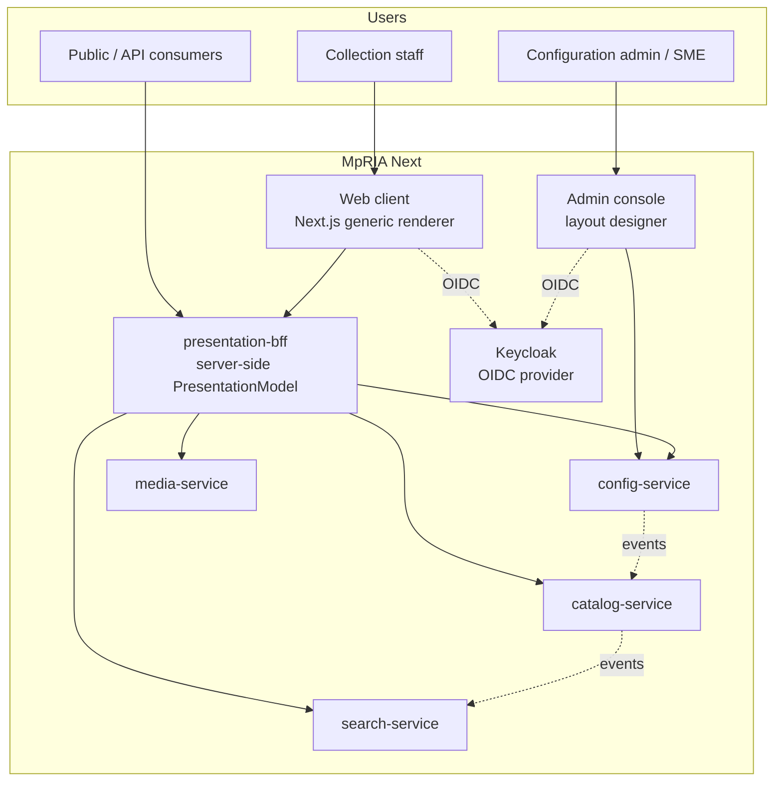
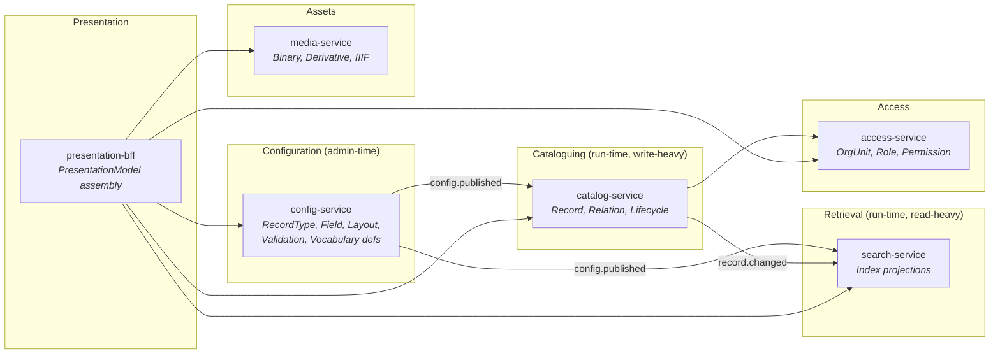

# MpRIA Next — Technical Architecture

> Status: **Draft for review** · Date: 2026-08-01 · Owner: Tushar Tari
>
> Target: a simplified, framework-agnostic successor to MpRIA (Vaadin 8 / Payara 5 monolith).

---

## 1. Purpose and scope

MpRIA today is a **meta-level framework for collection management**: customers do not get a
museum application, they get a configurable one. That property is the product, and it is the one
thing this rewrite must not lose.

Everything else is negotiable, and most of it is being renegotiated:

| Concern | MpRIA (v8) | MpRIA Next |
| --- | --- | --- |
| Language / runtime | Java 8, Payara 5, EJB | Java 21, Spring Boot 4, plain JVM containers |
| UI | Vaadin 8 server-side widgets | Any client. Reference client is Next.js/React |
| Presentation model | Java classes coupled to Vaadin | Java classes emitting **JSON**; no UI framework on the classpath |
| Customisation | Groovy custom code (~210 scripts) driving persistence + events | Declarative configuration + typed extension points |
| Configuration tool | ULC configuration application | `config-service` — independently deployable, admin-only |
| Data model | Generic DOM containers / data dictionary, EAV-ish | Per-context Postgres, spine columns + `jsonb` payload |
| Deployment | One WAR, one app server | Independently deployable services, Compose (on-prem) → Helm/K8s (SaaS) |
| Tests | Retrofitted; Selenium-heavy | TDD from commit #1; Selenium/Playwright at the tip only |

### 1.1 What we deliberately keep

1. **The layering.** `View → PresentationModel → ApplicationModel/Domain → Repository`. It is a
   good separation and it survives — see §6 for how it maps onto a distributed system.
2. **Configuration over code.** A customer-specific behaviour that can be expressed as data must be
   expressed as data.
3. **Domain neutrality.** No `Artist`, `Painting`, or `Museum` in framework code. The
   framework knows `RecordType`, `Field`, `Relation`. That rule carries over verbatim.

### 1.2 What we deliberately drop

1. **Groovy as a persistence/event layer.** Custom code that can rewrite persistence is the single
   largest source of untestable behaviour in v8. Replaced by (a) declarative config, (b) versioned
   domain events, (c) typed, sandboxed extension points that *cannot* reach the repository.
2. **DOM containers.** See §9 — replaced by a spine-plus-`jsonb` model.
3. **Server-side UI state.** The v8 session holds the whole UI tree. The new PM is computed and
   stateless per request; scaling stops being a session-affinity problem.

### 1.3 One concern, stated up front

You asked for **microservices from the start**. That is what is designed below, and that is what is
built. Be aware of the cost you are buying: with a two-to-five person team, distributed
transactions, N deployment pipelines, and cross-service debugging will consume real capacity
before the first customer sees value.

The mitigation baked into this design is that every service is internally a **Spring Modulith** with
explicit module boundaries and verified dependencies. If a split turns out to be wrong, modules can
be merged or re-cut without rewriting the domain. Boundaries are drawn where the *data ownership*
is genuinely disjoint (§5), not where an org chart suggests. If you later want to collapse
`catalog` + `relation` into one deployable, that is a pom change, not a redesign.

---

## 2. Architecture principles

| # | Principle | Consequence |
| --- | --- | --- |
| P1 | The domain never imports a UI framework | Nothing under `domain/` may reference HTTP, JSON, or React. Enforced by ArchUnit. |
| P2 | One writer per aggregate | Every table has exactly one service allowed to write it. No shared databases. |
| P3 | Contract-first | OpenAPI + JSON Schema are the source of truth; TypeScript types are generated, never hand-written. |
| P4 | Configuration is versioned data | Every config change is an immutable, exportable, diff-able revision. |
| P5 | Synchronous for reads, asynchronous for effects | Queries may fan out over HTTP. Side effects cross services only as events. |
| P6 | Tests define the contract | No production class exists before a failing test names it. |
| P7 | Self-hostable by default | Every infrastructure dependency must be OSS and runnable on a single node. |

P7 is load-bearing for your deployment answer: MVP ships on-prem, so no managed-cloud service may
become structural. Everything below (Keycloak, Postgres, Kafka/Redpanda, OpenSearch, Grafana) runs
in a customer's own datacentre and is swappable for a managed equivalent when you move to SaaS.

---

## 3. System context



The important edge is `WEB → BFF`. The web client asks for *a screen*, not for *an object*. It
receives a presentation model and renders it. That is what makes the frontend framework
replaceable: swapping Next.js for SvelteKit means rewriting a renderer, not an application.

---

## 4. Technology stack

| Layer | Choice | Why this and not the obvious alternative |
| --- | --- | --- |
| Language | **Java 21** (LTS) | Records, sealed interfaces, pattern matching, virtual threads. Java 25 is also LTS — see ADR-0001 for the upgrade trigger. |
| Framework | **Spring Boot 4.1** | Spring Modulith, Spring Authorization Server, `RestClient`, first-class OTel. Quarkus was considered (faster cold start, smaller on-prem footprint) — see ADR-0002. |
| Build | Maven multi-module | Team already fluent; the v8 monorepo layout transfers. |
| Persistence | **PostgreSQL 17** + **Hibernate ORM 7** + Flyway | `jsonb` + GIN + generated columns is what makes §9 possible. Hibernate, not EclipseLink — the payload column maps via `@JdbcTypeCode(SqlTypes.JSON)`, which has no portable JPA equivalent. A Maven Enforcer rule bans `org.eclipse.persistence:*` so it cannot arrive transitively. |
| Search | **OpenSearch** (BM25) + **pgvector** (semantic) | Hybrid retrieval. OpenSearch is Apache-2.0, self-hostable, and doubles as the log store. |
| Graph | Explicit edge tables + recursive CTEs | See ADR-0006 — a dedicated graph DB is deferred until traversal depth justifies it. |
| Messaging | **Kafka** (Redpanda for on-prem single-node) | Transactional outbox → topic. Redpanda keeps the on-prem footprint to one binary. |
| Identity | **Keycloak** (OIDC / OAuth 2.1) | Self-hostable, brokers to customer IdPs (AzureAD, Shibboleth), scales independently. |
| Web client | **Next.js 15 / React 19**, TypeScript | Reference renderer only. The PM contract is client-agnostic. |
| Styling | CSS Modules + design tokens, **flex + CSS Grid** | No raster/absolute layout anywhere. Container queries for component-level responsiveness. |
| Metrics/traces | OpenTelemetry → Prometheus + Grafana + Tempo | Vendor-neutral instrumentation; swap the backend without touching code. |
| Logs | Fluent Bit → **OpenSearch** → OpenSearch Dashboards | Your "ELK" requirement, OSS-licensed, and it reuses the cluster search already needs. |
| Tests | JUnit 6, AssertJ, Testcontainers 2, ArchUnit, Pact, Vitest, Playwright | §14. |

---

## 5. Bounded contexts

Boundaries follow **data ownership** and **rate of change**, not layers.



### 5.1 Context responsibilities and transaction boundaries

| Context | Owns (writes) | Transaction boundary | Consistency with others |
| --- | --- | --- | --- |
| **config-service** | `record_type`, `field_def`, `layout`, `validation_rule`, `config_revision` | One config **revision** commits atomically. A revision is all-or-nothing. | Publishes `ConfigurationPublished(revisionId)`. Consumers pull the revision and pin to it. |
| **catalog-service** | `catalog_record`, `catalog_record_relation`, `record_lifecycle_event` | **One record aggregate = one transaction.** A relation between two records commits in the same tx because both edges live in this context. | Publishes `RecordChanged` via transactional outbox. |
| **search-service** | OpenSearch indices, `pgvector` embeddings | Per-document idempotent upsert. No business transactions. | Eventually consistent (target < 2 s p95). Read models only — never a source of truth. |
| **media-service** | `media_asset`, `derivative`, object storage | Upload = two-phase: reserve row → stream to storage → commit. Orphan sweeper reconciles. | Publishes `MediaAttached`. |
| **access-service** | `org_unit`, `role`, `permission_grant` | Grant/revoke is a single tx. | Decisions cached in callers with a short TTL + revocation event. |
| **presentation-bff** | **Nothing.** Stateless. | No transactions. Writes are delegated, never composed. | If a screen needs two writes, that is a saga in a domain service, not a BFF loop. |

**The rule that keeps this sane:** the BFF may *read* from many services in one request. It may
**never** write to more than one. Any multi-service write is modelled as an explicit saga owned by
a domain service, with compensations.

### 5.2 Saga example — "publish a record"

```
catalog-service            search-service         media-service
     │
     ├─ tx: lifecycle=PUBLISHED, outbox row  ← the only ACID boundary
     │
     └─ RecordPublished ──┬──▶ index upsert         (retry, idempotent)
                          └──▶ derivative generation (retry, idempotent)
```

No two-phase commit. Consumers are idempotent on `(recordId, version)`. Failure is visible as
consumer lag in Grafana, not as a corrupted record.

---

## 6. The layering, preserved

Your v8 layering maps onto the distributed system like this:

| v8 layer | v8 module | MpRIA Next home |
| --- | --- | --- |
| View | `MpApplicationVaadinView` | `web/` — a **generic renderer**. Contains no domain logic at all. |
| PresentationModel | `MpApplicationModel` | `presentation-bff` — Java, emits JSON. **Not** in the browser. |
| Application/Service | `MpServices` (EJB) | Each domain service's `application/` module (use cases, transaction boundaries). |
| Domain | scattered | Each domain service's `domain/` module (entities, invariants, pure). |
| Repository/Persistence | `MpDAO`, `MpJPA` | Each domain service's `infrastructure/persistence/`. |

Inside every service, the package structure and its enforced dependency direction:

```
com.zetcom.mpria.<context>
├── domain/            ← pure. no Spring, no JPA, no HTTP. depends on nothing.
├── application/       ← use cases, ports, @Transactional. depends on domain.
├── infrastructure/    ← adapters: JPA, Kafka, HTTP clients. depends on application + domain.
└── api/               ← REST controllers, DTOs. depends on application.
```

`ArchitectureTest` (ArchUnit) fails the build on any violation. This is the single most valuable
guardrail you can install on day one, because it is the boundary v8 lost gradually rather than
suddenly.

---

## 7. The Presentation Model contract

This is the heart of the design and the reason the frontend is replaceable.

### 7.1 Shape

A `PresentationModel` is a JSON document with four parts:

```jsonc
{
  "meta":    { "screenId", "revisionId", "recordId", "etag", "capabilities": ["EDIT","DELETE"] },
  "layout":  { /* a tree of regions and slots — see docs/ui-configuration.md */ },
  "fields":  { /* fieldId -> { type, label, value, options, state, validation } */ },
  "actions": [ /* { id, label, method, href, confirm, enabled } */ ]
}
```

Key properties:

- **`layout` and `fields` are separate.** Layout comes from configuration, field state comes from
  data + permissions. The admin can move a field without any data change, and a permission change
  can disable a field without any layout change.
- **`actions` are hypermedia.** The client never constructs a URL or decides whether a button is
  allowed. `enabled: false` with a `reason` is computed server-side from ACL + lifecycle +
  validation. This kills an entire class of client/server authorisation drift.
- **`state` per field** carries `readOnly`, `required`, `hidden`, `errors[]`. The renderer applies
  them mechanically; it has no idea *why* a field is read-only.

### 7.2 Why server-side and not a TypeScript PM

Three reasons specific to your product:

1. Business rules that decide "is this field required for this record type in this org unit" are
   domain rules. Duplicating them in TypeScript means maintaining them twice and drifting once.
2. The configuration application (§8) writes layouts consumed by the PM. If the PM is server-side,
   the admin's change takes effect on the next request with no client deployment.
3. It preserves your existing team's mental model and the `MpApplicationModel` test suite's shape.

The cost is a chattier contract and a BFF that must be fast. Mitigation: the BFF is stateless,
horizontally scalable, and caches configuration by `revisionId` (immutable, so cacheable forever).

### 7.3 Rendering contract

The renderer implements exactly one function:

```ts
render(pm: PresentationModel): ReactNode
```

It maps `field.type` → a component from a registry. Adding a new field type is registering a
component; adding a new *screen* requires no frontend work at all. That property is the acceptance
test for this whole design.

---

## 8. Configuration and the admin application

Full design in **[`docs/ui-configuration.md`](docs/ui-configuration.md)**. Summary:

- `config-service` is an **independently deployable Spring Boot service** with its own database,
  its own OIDC client, and a role gate (`mpria-config-admin`). It can run while the rest of the
  platform is down, and the rest of the platform can run while it is down (consumers cache the
  last published revision).
- Configuration is **immutable revisions**. `DRAFT → VALIDATED → PUBLISHED`. Publishing emits an
  event; nothing reads a draft.
- **Export/import** produces a signed bundle (`config-bundle.zip`: `manifest.json`, `record-types/`,
  `layouts/`, `vocabularies/`, `validations/`). This is how "standard configuration + customised"
  works: a base bundle ships with the product, a customer bundle *overlays* it, and the overlay is
  a diff that survives base upgrades.
- The **layout designer** is drag-and-drop onto a responsive grid: the admin places components into
  a 12-column grid with per-breakpoint spans. Output is declarative layout JSON, not code.

---

## 9. Data architecture

### 9.1 The problem with DOM containers

The v8 generic data model buys unlimited configurability at the cost of: no useful foreign keys,
no meaningful indexes without machinery, queries that are joins-over-joins, and a schema no DBA
can reason about. `MpDAO` alone carries ~100 `DomContainerNNDaoTest` classes — that is the
complexity made visible.

### 9.2 The replacement: spine + `jsonb`

```sql
CREATE TABLE catalog_record (
    id              uuid        PRIMARY KEY,
    tenant_id       uuid        NOT NULL,
    record_type     text        NOT NULL,   -- configured, not hardcoded
    schema_version  int         NOT NULL,
    identifier      text,                   -- inventory number, human key
    title           text,                   -- derived from the type's title expression
    lifecycle       text        NOT NULL,
    data            jsonb       NOT NULL,   -- the configured fields
    org_unit_id     uuid        NOT NULL,   -- ACL anchor
    created_at      timestamptz NOT NULL,
    created_by      text        NOT NULL,
    updated_at      timestamptz NOT NULL,
    updated_by      text        NOT NULL,
    version         bigint      NOT NULL    -- optimistic locking
);

CREATE INDEX ON catalog_record USING gin (data jsonb_path_ops);
CREATE INDEX ON catalog_record (tenant_id, record_type, lifecycle);
```

Why this is the right trade:

- **Simple.** One table for all record types. A developer can `SELECT *` and understand it.
- **Configurable.** Adding a field is a config change; no DDL, no migration.
- **Indexable.** GIN covers ad-hoc `jsonb` predicates. Hot fields get promoted to *generated
  columns* with a btree index — a targeted optimisation, not an upfront design decision.
- **Validated.** `config-service` publishes the **field definitions** for each
  `(record_type, schema_version)`; `catalog-service` compiles them into a validator and checks every
  write against it — required fields, declared types, lengths, enum membership, and rejection of any
  key the configuration does not define. Configurability without a schema-less free-for-all.
- **Migratable.** `schema_version` on the row means old documents stay readable; an upcaster
  normalises on read and a background job rewrites lazily.

### 9.3 Relations as first-class edges

```sql
CREATE TABLE catalog_record_relation (
    id            uuid PRIMARY KEY,
    tenant_id     uuid NOT NULL,
    from_record   uuid NOT NULL REFERENCES catalog_record(id) ON DELETE CASCADE,
    to_record     uuid NOT NULL REFERENCES catalog_record(id) ON DELETE CASCADE,
    relation_type text NOT NULL,
    ordinal       int  NOT NULL DEFAULT 0,
    attributes    jsonb NOT NULL DEFAULT '{}'
);
```

Real foreign keys — something DOM containers could not give you. Traversal uses recursive CTEs,
which comfortably handles the depth-3-to-5 queries a collection system actually asks
("show me everything in this exhibition, and their owners, and their locations").

### 9.4 Search: hybrid, not graph-database-shaped

You asked for graph or vector for search. The honest split:

| Need | Solution | Where |
| --- | --- | --- |
| Full-text, facets, aggregations | OpenSearch, one index per `(tenant, record_type)` | search-service |
| Semantic / "find things like this" | `pgvector`, embeddings on the title + narrative fields | search-service (Postgres) |
| Relationship traversal | Recursive CTE over the edge table | catalog-service |
| Deep multi-hop analytics | *Deferred.* Neo4j or Apache AGE, added as a projection if a real use case appears | — |

Adding a graph database now would be a third datastore serving a query pattern you have not yet
proven you need. ADR-0006 records the trigger condition for revisiting: any traversal exceeding
four hops, or any query the CTE cannot serve under 200 ms p95.

### 9.5 Multi-tenancy, staged

Your deployment answer (on-prem MVP → SaaS later) makes this a schedule, not a fork:

| Phase | Model | Isolation |
| --- | --- | --- |
| MVP (on-prem) | One deployment per customer, `tenant_id` present but always a single value | Physical |
| SaaS v1 | Schema-per-tenant in a shared Postgres | Strong; simple backup/restore per customer |
| SaaS scale | Row-level security on `tenant_id`, shared schema, for the long tail of small tenants | Logical, enforced by Postgres RLS |

`tenant_id` is on every table **from day one** even though the MVP has one tenant. Retrofitting it
later is the migration nobody wants to do.

---

## 10. Identity and access

- **Keycloak** as the OIDC provider, deployed and scaled independently (stateless with an external
  Infinispan/DB store).
- Browser clients use **Authorization Code + PKCE**. No tokens in `localStorage` — the Next.js
  route handlers hold the refresh token in an encrypted, `HttpOnly`, `SameSite=Lax` cookie and
  attach the access token server-side. (This also sidesteps the `Secure`-cookie/localhost pain you
  already hit in the v8 load tests.)
- Services are **OAuth 2 resource servers** validating JWTs against the realm JWKS. No shared
  session state, no sticky sessions — this is what unblocks horizontal scaling.
- Service-to-service uses the **client-credentials** grant with per-service clients and audience
  restriction, so a compromised BFF token cannot write to `config-service`.
- **Coarse** authorisation (can this principal reach this endpoint) is scope/role-based in the
  filter chain. **Fine** authorisation (can this principal edit *this record's* org unit) lives in
  `access-service` and is applied in the domain service, never in the BFF.
- Customer IdP integration is Keycloak **identity brokering** — a config task, not a code task.

---

## 11. Observability

```
services ──OTLP──▶ OpenTelemetry Collector ──┬──▶ Prometheus   (metrics)
                                             ├──▶ Tempo        (traces)
                                             └──▶ OpenSearch   (logs, via Fluent Bit)
                                                      │
                                              Grafana + OpenSearch Dashboards
```

- Every service exports OTLP. Instrumentation is the OTel Java agent plus explicit spans on use
  cases. Zero vendor lock-in: the collector is the only thing that knows where data goes.
- **Structured JSON logs**, one event per line, always carrying `traceId`, `spanId`, `tenantId`,
  `userId`, `recordId`. A support engineer pastes a trace ID into OpenSearch Dashboards and gets
  the whole request across five services. That is the capability v8 lacks.
- Golden signals per service (rate, errors, duration, saturation) plus domain SLOs: PM assembly
  p95 < 300 ms, search indexing lag p95 < 2 s, config publish → visible < 5 s.
- **Log hygiene is a build concern.** A `LoggingConventionTest` fails the build on `System.out`,
  on unparameterised string concatenation in log calls, and on any log statement that could emit a
  field marked `sensitive` in the configuration.

---

## 12. Frontend architecture

- **Next.js 15 / React 19**, App Router, TypeScript strict.
- Two entry points: the **operator client** (generic renderer) and the **admin console** (layout
  designer). Same design system, separate bundles, separate OIDC clients.
- **Layout: hybrid flex + CSS Grid, no raster.** Grid owns the two-dimensional form layout
  (the admin's 12-column canvas maps to `grid-template-columns`); flex owns one-dimensional
  component internals (toolbars, field label/control/help stacks).
- **Container queries**, not only viewport media queries. A field group renders differently in a
  narrow side panel than in a wide main region *at the same viewport width* — this is exactly what
  a configurable-layout product needs, and it is why raster positioning had to go.
- Design tokens in CSS custom properties (spacing, colour, type scale, radii), light and dark.
- TypeScript types for the PM are **generated** from the backend JSON Schema (`json-schema-to-typescript`)
  and checked into CI as a drift test. A backend PM change that breaks the client fails the
  backend build.

---

## 13. Deployment

| Phase | Artifact | Runtime |
| --- | --- | --- |
| Dev | `docker compose up` | One node, everything local |
| MVP / on-prem | Versioned Compose bundle **and** a Helm chart | Customer's Docker host or small K8s |
| SaaS | Helm chart + GitOps (Argo CD) | Managed K8s (EKS) |

Every service is a distroless container built with `jib` — reproducible, no Dockerfile drift,
no root. Images are the same artifact in all three phases; only the orchestration differs. That
is what keeps "on-prem forever" from becoming a second product.

Database migrations run as an **init container / pre-upgrade hook**, never on application startup,
so a rolling deploy cannot have two schema versions racing.

---

## 14. Testing strategy (TDD from commit #1)

The discipline: **no production class is created before a failing test names it.** Concretely, per
layer:

| Level | Scope | Tools | Speed target |
| --- | --- | --- | --- |
| **Domain unit** | Pure invariants — no Spring context | JUnit 6, AssertJ | < 5 ms/test |
| **Architecture** | Layer boundaries, package rules, no domain→infra imports | ArchUnit | runs in `test` |
| **Use case** | Application services with in-memory ports | JUnit + hand-rolled fakes | < 50 ms |
| **Persistence** | Real Postgres, real Flyway, real `jsonb` | Testcontainers 2 | reused container |
| **API** | Controller + security, mocked application layer | `MockMvcTester`, mock JWT | fast |
| **Contract** | Consumer-driven; BFF's expectations verified against each provider | Pact | CI gate |
| **Renderer** | PM JSON → DOM, no backend | Vitest + Testing Library | fast |
| **E2E** | Two or three journeys only, real stack | Playwright | nightly |

Two rules learned from v8's test suite:

1. **Selenium/Playwright is the tip, never the body.** The v8 integration tests wipe server
   configuration on `setUp` — a test suite that can destroy an environment is a test suite people
   stop running. E2E here is read-mostly, runs against a disposable stack, and owns its own tenant.
2. **Fakes over mocks at the port boundary.** An `InMemoryRecordRepository` that actually enforces
   the aggregate's invariants catches more than a Mockito stub that returns whatever the test says.

CI gates, in order, fail-fast: `compile → arch → unit → contract → integration → e2e(nightly)`.
Coverage is measured but not targeted; the gate is mutation score (PIT) on `domain/` — a number
that cannot be gamed by asserting nothing.

---

## 15. Roadmap

| Phase | Deliverable | Proves |
| --- | --- | --- |
| **0 — Walking skeleton** *(built, see `services/`, `web/`)* | Login → configured layout → render → edit → save → reload | The PM contract works end to end |
| **1 — Cataloguing core** | Full field-type catalogue, relations, lifecycle, optimistic locking, validation from config | The `jsonb` model holds a real record type |
| **2 — Configuration app** | Drag-and-drop designer, revisions, export/import, base+overlay bundles | Configurability without code |
| **3 — Retrieval** | OpenSearch projection, hybrid vector search, facets, saved searches | Read path scales independently |
| **4 — Access & tenancy** | Org units, ACL, Keycloak brokering, RLS groundwork | Multi-customer readiness |
| **5 — Media** | Upload, derivatives, IIIF | Feature parity on assets |
| **6 — Ops** | Full OTel stack, ELK, Helm chart, backup/restore runbook | On-prem shippable |

---

## 16. Architecture Decision Records

| ADR | Decision |
| --- | --- |
| [0001](docs/adr/0001-java-21.md) | Java 21 as the baseline runtime |
| [0002](docs/adr/0002-spring-boot-over-quarkus.md) | Spring Boot 4 over Quarkus |
| [0003](docs/adr/0003-server-driven-ui.md) | Server-side presentation model emitted as JSON |
| [0004](docs/adr/0004-jsonb-over-eav.md) | Spine + `jsonb` instead of DOM containers / EAV |
| [0005](docs/adr/0005-no-groovy-custom-code.md) | Declarative config + typed extension points instead of Groovy |
| [0006](docs/adr/0006-defer-graph-database.md) | Defer a dedicated graph database |
| [0007](docs/adr/0007-microservices-with-modulith-cores.md) | Microservices, each internally a Spring Modulith |

---

## 17. Open questions

1. **Vocabulary / thesaurus.** v8 has online vocabulary integration (`OnlineVocabularyPresentationModel`).
   Own context or part of `config-service`? Leaning: its own, because it has external integrations
   and a different change rate.
2. **Extension points.** §1.2 removes Groovy. The replacement needs a concrete design: WASM
   sandbox, a restricted expression language (CEL/SpEL subset) for computed fields and validation,
   or out-of-process webhooks. Recommendation: expression language for the 90 % case, webhooks for
   the rest, no in-process scripting ever.
3. **Migration.** Answered as *clean slate* for architecture purposes, but a customer eventually
   needs their data. A one-off ETL from DOM containers → `jsonb` is a Phase-7 project, not a
   constraint on this design.
4. **Reporting/export.** v8's Excel/table export is a real customer workflow. Likely a
   `report-service` consuming the search index rather than the write model.
